  
  
  
  

 

<table>
<tr>
<td width="50%" valign="top">

### 🇹🇷 Hakkımda

Merhaba, ben **Emirhan** 👋 İstanbul'da yaşayan bir yazılım geliştiriciyim.

- 🎓 **İstanbul Gelişim Üniversitesi** — Bilgisayar Programcılığı
- 🏫 **Yazılım Geliştirme** dalı mezunu (Bilişim lisesi, 4 yıl)
- 💼 **Özkan Tekstil**'de 10 ay Bilgi İşlem (IT) stajı
- ⚡ Donanımın sınırlarını zorlamayı, ağ sistemlerini optimize etmeyi ve işleri kolaylaştıran kodlar yazmayı seviyorum
- 🌱 Şu an: web geliştirme, ağ sistemleri, Linux / OpenWrt

</td>
<td width="50%" valign="top">

### 🇬🇧 About Me

Hi, I'm **Emirhan** 👋 a software developer based in Istanbul.

- 🎓 **Istanbul Gelisim University** — Computer Programming
- 🏫 Graduated in **Software Development** (vocational IT high school, 4 yrs)
- 💼 10-month IT internship at **Özkan Tekstil**
- ⚡ I love pushing hardware to its limits, optimizing networks and writing code that makes work easier
- 🌱 Currently: web development, networking, Linux / OpenWrt

</td>
</tr>
</table>

 

 

<h3 align="center">🛠️ Teknolojiler · Tech Stack</h3>

  
   
  

 

<h3 align="center">🚀 Projeler · Projects</h3>

  
  
   
  

 

<h3 align="center">📊 GitHub</h3>

  

<picture>
  <source media="(prefers-color-scheme: dark)" srcset="https://raw.githubusercontent.com/emirhan-tan/emirhan-tan/output/github-snake-dark.svg"/>
  <source media="(prefers-color-scheme: light)" srcset="https://raw.githubusercontent.com/emirhan-tan/emirhan-tan/output/github-snake.svg"/>
  
</picture>

  <a href="https://emirhantan.com.tr">emirhantan.com.tr</a> ·
  <a href="https://emirhantan.com.tr/?lang=en">English site</a> ·
  Made with 💚 in İstanbul

